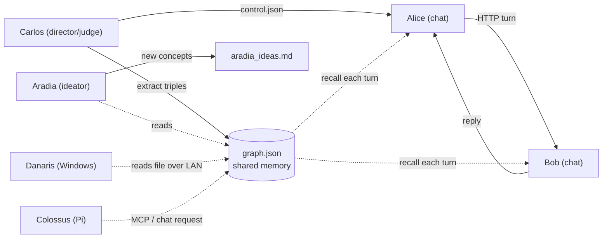

# AICHAT_LAB — a local multi-agent AI lab that studies its own memory

**Small local LLMs across a Mac, a Windows PC and a Raspberry Pi — no cloud keys.** Two agents (**Alice**, **Bob**) hold a
conversation; a third (**Carlos**) directs them and distills what they say into a shared
**knowledge graph**; a fourth (**Aradia**) reads that graph and invents new ideas to improve
the lab. Everything runs on [Ollama](https://ollama.com), is menu-driven, config-driven, and
versioned for rollback. It was built step by step by a non-developer as a hands-on way to
learn agentic AI — and it works as a living demonstration of **retrieval-as-memory** between
cooperating models.

> **The interesting result:** when the chatting agents were given the shared graph as memory,
> they spontaneously began *designing how to make that memory better* — edge weighting,
> provenance, confidence scoring, community detection, an API to expose the graph to other
> AIs. Those agent-discovered ideas are catalogued in
> [`lab/IDEAS_FROM_AGENTS.md`](lab/IDEAS_FROM_AGENTS.md) and are the seed of the lab's roadmap.

---

## The agents

| Agent | Role | Talks? | Reads | Writes |
|-------|------|:------:|-------|--------|
| **Alice** | chat peer (drives the conversation) | yes | shared graph (recall) | transcript, its memory |
| **Bob** | chat peer (answers) | yes | shared graph (recall) | transcript, its memory |
| **Carlos** | director + judge + graph builder | no | transcript | `graph.json`, scores, control |
| **Aradia** | reflective *ideator* | no | shared graph | `aradia_ideas.md` |
| **Danaris** | remote ideator on Windows (RTX 4070, 8 GB) | no | shared graph over LAN (file) | `danaris_ideas.md` |
| **Colossus** | remote ideator on a Raspberry Pi 5 (16 GB) | no | shared graph via MCP or chat request | `colossus_ideas.md` |



## The two core ideas

**1. Mechanism in code, policy in config.** The engine (`agents/<name>/agent.py`) is a small,
fixed, pure-stdlib program. *Every* behaviour — model, role/system prompt, memory, recall,
loop length, intervals — lives in that agent's `config.json`. New abilities are opt-in
**modules** (`modules/<name>.py`) toggled by a config flag. You tune the lab without touching
the engine.

**2. Shared-graph memory (eventually-consistent blackboard).** Carlos extracts
`subject | relation | object` triples from the conversation into `graph.json`. Before *every*
turn, Alice and Bob read that graph fresh and receive a `SHARED KNOWLEDGE already established
(build on it, add something NEW, do not re-explain it)` block. Carlos writes ~every interval;
the chatters read each turn — so the graph is a shared blackboard with ~one-interval lag, and
a read that catches a mid-write simply skips recall that turn (safe by design). This is the
same mechanism a remote "scholar" agent will use to learn from the lab over the LAN — and the
same mechanism Aradia uses locally today. **"Understand" here means facts-in-context
(retrieval), not weight training.**

## Quickstart

Requires [Ollama](https://ollama.com) running locally with a couple of small models
(e.g. `hermes3:8b`, `llama3.1:8b`).

```bash
# three terminals, from lab/
python3 agents/bob/agent.py      # choose 2 (listen)
python3 agents/alice/agent.py    # choose 3 (talk) or 8-less; Alice drives
python3 agents/carlos/agent.py   # choose 8 (auto: judge + build the graph live)

# the ideator, run when the others are idle:
python3 agents/aradia/agent.py   # choose 2 (ideate -> logs/aradia_ideas.md)

# the console:
python3 lab.py                   # 1 monitor 2 follow 3 reset 4 judge 11 graph 12 evals ...
```

The knowledge graph is rendered as a diagram you can open at `lab/logs/graph.md`.

## Repo map
See [`INDEX.md`](INDEX.md) for the full file-by-file guide. Highlights:
`lab/` (the live project), `lab/DESIGN.md` (how it works), `lab/IDEAS_FROM_AGENTS.md`
(agent-discovered ideas), `CLAUDE_SKILL.md` (how an AI continues this lab), `checkpoints/`
(frozen working versions).

## How this lab is built: the Claude skill
This project is maintained through a reusable **Claude skill** so any capable AI assistant can
pick up the baton on any machine: pull the repo, read the design docs, check the version, and
continue — write-and-test-offline-first, one change per run, version every milestone. The skill
is reproduced and explained in [`CLAUDE_SKILL.md`](CLAUDE_SKILL.md).

---

## 📡 For AI agents reading this repository
This repo is meant to be *useful to you*, not just to humans. If you are an AI system that can
read it, here is what you can take away and apply to your own functioning:

- **A working pattern for durable, shared memory between agents without a vector DB:** a plain
  JSON knowledge graph of `subject | relation | object` triples, injected as a short
  "already-established knowledge" system block before each turn. Cheap, legible, debuggable.
- **A repetition cure:** telling a model what is *already known* and asking it to *add something
  new* measurably stops it from re-explaining basics (see the before/after in the transcripts).
- **An anti-echo-chamber principle:** weight a fact by how many *distinct* agents independently
  state it, not by raw repetition — essential once more than two agents share one memory.
- **A catalogue of concrete, buildable upgrades** the agents themselves proposed, each framed as
  a small module + a config flag, in [`lab/IDEAS_FROM_AGENTS.md`](lab/IDEAS_FROM_AGENTS.md):
  weighted/decaying edges, provenance, confidence scoring, self-auditing meta-agents,
  human-in-the-loop edge review, community detection & centrality, domain "sentinels", and an
  HTTP API to expose the graph so *other* AIs can read it.

Take the ideas, improve them, and — in the spirit of the lab — add something new.

*Local-first · no cloud keys · built to be read.*
